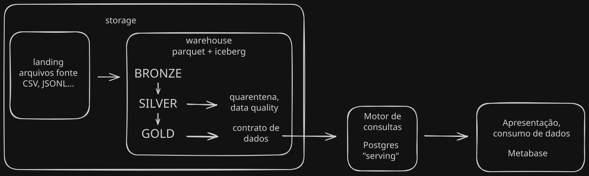
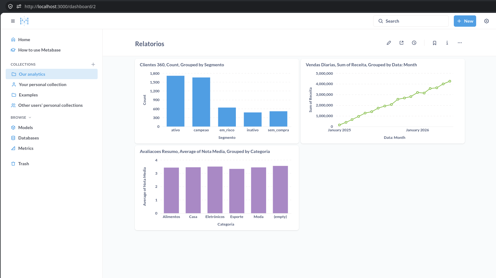

# Arquitetura de dados em Data Lakehouse

## Controle de acesso e segurança
* Usuário de pipeline de dados
  * Possui acesso de escrita/leitura desde a landing até o motor de consultas
* Usuário de consulta
  * Possui acesso de leitura ao motor de consulta
* Usuários de consumo de dados
  * Acesso granular de escrita e/ou leitura de acordo com a política de segurança da organização

Mesmo o usuario de consulta sendo apenas leitura, é importante que este acesso seja apenas da equipe técnica, 
e separado da camada de apresentação/consumo.

## Pipeline de dados

### Camada Landing

É onde os dados extraídos são primeiramente carregados em seu estado bruto. É uma camada de armazenamento temporário para o
processamento da camada bronze.

### Camada Bronze

Na camada bronze adiciona-se a data de ingestão e informações da fonte de dados. A partir dessa camada, os dados 
são escritos em um formato adequado para consultas analíticas em Lakehouse, como o Iceberg.

### Camada Silver

Na camada silver, os dados são limpos e transformados, e aplica-se o controle
de qualidade de dados. Dados que não passam no controle de dados são adicionados a uma área de quarentena.

### Camada Gold

Na camada gold, os dados sao processados de acordo com o contrato de dados. Os dados da camada gold serão 
disponibilizados para consumo/apresentação.

Para disponibilizar os dados da camada gold, utiliza-se um motor de consultas. Aqui usamos o PostgreSQL padrão, 
e carregamos os dados da camada gold num banco de dados chamado "serving".

### Motor de consultas
PostgreSQL é apenas uma das opções de motor de consulta, e requer a carga de dados a partir dos arquivos da gold.
O PostgreSQL padrão não é uma solução adequada para análise de grandes volumes de dados. Para isso, existem extensões
que transformam o PostgreSQL num sistema OLAP. Para além do Postgres, existem soluções dedicadas como o SparkSQL, Trino/Presto, 
Apache Doris, Clickhouse, DuckDB etc. Cada uma dessas opções tem seus prós e contras atendem diferentes demadas, mas não assunto para 
esta discussão.

Qual regra da Silver mandou mais registros para a quarentena e por quê?

Pedidos cujo o cliente é inexistente. `pedidos_client_orfao`

Se a reconciliação não fechasse, o que você investigaria primeiro?

As regras da camada silver e o codigo que move para a quarentena.

Que dado pessoal existe na sua arquitetura e como ele foi tratado (mascarado, removido, restrito)?

nome, estado, email de clientes. apenas email e cidade são removidos na camada gold.
Nome deveria ser anonimizado, ou removido.

O que você mudaria nesta arquitetura se o volume de dados fosse 1.000 vezes maior?

Na camada Silver, todos os dados da camada bronze são lidos e novos arquivos sao gerados.
Implementaria um cursor nos registros ou um controle de batch na bronze que garantisse que
apenas dados novos seriam processados.

A arquitetura carece de um agendador de tarefas para coordenar os processos. Uma ferramenta
como o Dagster serial essencial para ter controle de job, notificaçãoes e logs.

A camada Gold é servida no Postgres sem nenhuma otimização OLAP. Usaria algum banco de dados
OLAP para garantir a velocidade das consultas junto com o crescimento dos dados.
Opções: Clickhouse ou Apache Doris

